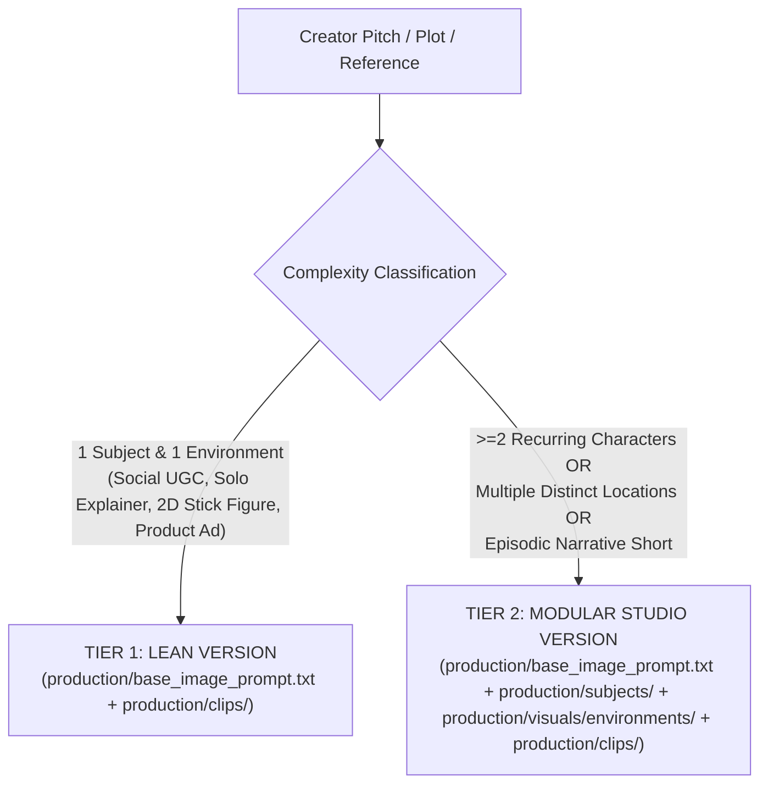

# Specification 07: Dynamic Workspace Scaffolding & Creator File Architecture

> **Live amendment (2026-11-15):** `Conditioned On:` and `Input Seed:` paths identify the prompt that produced an image already in the creator's Google Flow project. Select that image in Flow; do not upload the `.txt` file. Exported images are optional. Prompt creation does not imply rendering or assembly. The current cue-to-visual contract in `05_directors_cut_assembly_spec.md` governs clip planning over older examples below.

## Current clip-image lineage

The default is a **scene image chain**. A scene means a continuous location and time with stable visual identity. Its first clip image uses the approved base style and applicable subject/environment images. Each later clip image uses the **previous approved clip image** from the same scene as the local continuity reference, plus the stable subject/environment images when the chosen Flow image workflow allows them. The image prompt changes only what the next timed audio cue requires: framing, pose, expression, visible action, or viewpoint. Do not simply copy the prior composition if the next cue needs a new view.

When the environment or time changes, make a new scene-root clip image from the relevant stable anchors. If identity, room layout, scale, or lighting drifts, reject the bad image and restart from the scene root or stable anchors rather than chaining it forward. Record the image lineage in the existing `scratchbook.md` row (`scene root` or `previous approved clip image` and any reset reason); no new asset inventory or exported image file is required. The `.txt` path is a cue to select the corresponding generated image within Flow. The previous clip **image** is not its rendered video's terminal frame, so the creator still reviews actual cut continuity.

## Current `scratchbook.md` clip ledger

At the top of `production/scratchbook.md`, record `Template ID: video/<id>` for the live video template used to establish this project, or `Template ID: none`. The recovery skill uses this pointer if only `production/` is preserved. Keep the template itself in the existing template vault, not in the production folder. If the template is later changed or removed, the ID alone cannot recover its exact historical contents.

For each planned shot record: `Audio start–end | exact cue | required visible fact | subject/location | literal, reaction, or intentional withhold | shot scale and person-to-room proportion | reveal boundary | image lineage | generation duration (4/6/8/10) | planned edited duration | trim/hold | manual audio use`. Keep rows concise. Edited durations may be uneven. Verify adjacent edited intervals meet and each audio cue maps to a relevant visible event; total duration parity alone is insufficient. If the creator has not supplied actual audio times, label the ledger `PROVISIONAL`. After a re-recording, mark old clip times stale.

`production/audio_script.txt` must clearly separate human setup/cast instructions from the paste-only spoken transcript. Angle-tag behavior is specific to the chosen TTS model and interface; test a short sample before full audio. The creator supplies the final audio duration and time-coded transcript for separate-audio pass 2. No media export is required by this contract.

## 1. Architectural Philosophy: Brain vs. Creator Deliverables

In OpenProducer, **we do not copy static template folders containing dummy placeholder text**, and **OpenProducer NEVER generates any image on its own** (not even as an example to show the creator) unless the creator explicitly asks it to generate an image.

The workspace is strictly divided into two zones:
1. **`./openproducer/` (The Brain):** Internal producer state, configuration, style anchors, linter manifest, and full story/session memory (`blueprint.md`). Created/updated during `propose`, `sync`, and `template`.
2. **`./production/` (Creator Deliverables):** All clean, plain-text `.txt` prompt files (with zero markdown bloat) plus `.md` script/timeline files generated during `produce`. Kept strictly inside `production/` so the workspace root stays clean.

---

## 2. Project Tier Classification Logic

The Agent evaluates project complexity and selects one of two operating tiers:



### Classification Rules:
| Project Trait | Assigned Tier | Creator Scaffolding Behavior (inside `production/`) |
|---|---|---|
| Single host/creator in one studio/room | **Lean Version** | `base_image_prompt.txt` locks base style, face, and studio together. No `subjects/` or `visuals/environments/` folders needed. |
| 2D animation / Stick Figure explainer (single setting) | **Lean Version** | `base_image_prompt.txt` locks art style + character + canvas. Flat `clips/` directory. |
| Tabletop commercial product (watch, shoe) | **Lean Version** | `base_image_prompt.txt` locks lighting + product hero. Flat `clips/` directory. |
| Short film / animation with 2+ characters or multiple locations | **Modular Studio Version** | `base_image_prompt.txt` locks master visual style first; generates creator-facing `subjects/<id>/` and `visuals/environments/<id>/` `.txt` prompts inside `production/`. |

---

## 3. Directory Layout Contracts

### 3.1 Tier 1: Lean Version Workspace
*Optimized for single-subject or single-setting productions.*

```text
<project_root>/
├── openproducer/                  # 🧠 THE BRAIN (Internal Agent Context)
│   ├── config.json                # Project configuration, audio pathway & delivery settings
│   ├── state.json                 # Interactive stage tracker (explore | proposed | produced | guiding)
│   ├── blueprint.md               # Complete archived story, plot, plans & session memory
│   ├── manifest.json              # Pre-flight audit ledger for Linters L-01 to L-19
│   └── visual/
│       └── technical_anchor.txt   # The master 30-word visual style anchor string
│
└── production/                    # 🎬 CREATOR PRODUCTION DELIVERABLES
    ├── base_image_prompt.txt          # 🎨 CREATOR FILE: Master Base Style & Subject/Setting lock prompt
    ├── audio_script.txt               # 🎙️ CREATOR FILE: (If Separate Audio) Plain-text bracket-tagged script to generate/record voice/audio
    │
    ├── clips/                         # 🎬 CREATOR FOLDER: Shot-by-shot plain-text prompts
    │   ├── clip_01/
    │   │   ├── image_prompt.txt       # Scene root: base image; later same-scene clips: previous approved clip image
    │   │   └── video_prompt.txt       # Tier 3: Video prompt (Input Seed: production/clips/clip_01/image_prompt.txt)
    │   ├── clip_02/
    │   │   ├── image_prompt.txt
    │   │   └── video_prompt.txt
    │   └── clip_xxx/
    │
    ├── master_images_prompt.txt       # 📋 CREATOR REFERENCE ONLY: All image prompts compiled (ignored by /openproducer-guide)
    ├── master_videos_prompt.txt       # 📋 CREATOR REFERENCE ONLY: All video prompts compiled (ignored by /openproducer-guide)
    ├── scratchbook.md                 # 📝 CREATOR FILE: Timeline pacing table (4s/6s/8s), timestamps & retake log
    └── motion_graphics.md             # 🔤 CREATOR FILE: (If applicable) On-screen captions & typography cue sheet
```

---

### 3.2 Tier 2: Modular Studio Version Workspace
*Activated for multi-character or multi-environment productions. Because the creator must generate the character references and environment plates as base images in Google Flow / Imagen, `subjects/` and `visuals/environments/` live directly inside `production/`.*

```text
<project_root>/
├── openproducer/                  # 🧠 THE BRAIN (Internal Agent Context)
│   ├── config.json                # Tier: "modular_studio", Aspect: "16:9", etc.
│   ├── state.json                 # State tracker
│   ├── blueprint.md               # Complete archived story, character arcs & session memory
│   ├── manifest.json              # Pre-flight audit ledger (L-01 to L-19)
│   └── visual/
│       └── technical_anchor.txt   # Master style anchor string
│
└── production/                    # 🎬 CREATOR PRODUCTION DELIVERABLES
    ├── base_image_prompt.txt          # 🎨 CREATOR FILE: Master Base Style lock prompt (anchors all subjects & environments)
    ├── audio_script.txt               # 🎙️ CREATOR FILE: (If Separate Audio) Plain-text bracket-tagged script to generate/record voice/audio
    │
    ├── subjects/                      # 👥 CREATOR FOLDER: Character & Subject Base Prompts
    │   ├── <subject_id_or_name>/
    │   │   ├── hero_prompt.txt        # Step 1: Single Hero Shot prompt (Conditioned On: base_image_prompt.txt)
    │   │   └── profile_prompt.txt     # Step 2: 4-View Turnaround prompt (Conditioned On: hero_prompt.txt)
    │   └── <subject_2_name>/
    │       ├── hero_prompt.txt
    │       └── profile_prompt.txt
    │
    ├── visuals/                       # 🌆 CREATOR FOLDER: Environment Base Prompts
    │   └── environments/
    │       └── <environment_id_or_name>/
    │           ├── prompt.txt         # Empty 3-plane stage plate prompt (Conditioned On: base_image_prompt.txt)
    │           └── ground_rules.md    # MANDATORY: Scene topology, Z-index depth, and negative hallucination bans
    │       └── <environment_2_name>/
    │           ├── prompt.txt
    │           └── ground_rules.md
    │
    ├── clips/                         # 🎬 CREATOR FOLDER: Shot-by-shot plain-text prompts
    │   ├── clip_01/
    │   │   ├── image_prompt.txt       # Scene root: subject + environment; later same-scene clips: previous approved clip image + stable anchors when supported
    │   │   └── video_prompt.txt       # Video prompt (Input Seed: production/clips/clip_01/image_prompt.txt)
    │   ├── clip_02/
    │   │   ├── image_prompt.txt
    │   │   └── video_prompt.txt
    │   └── clip_xxx/
    │
    ├── master_images_prompt.txt       # 📋 CREATOR REFERENCE ONLY: All base, subject, environment & clip image prompts compiled (ignored by /openproducer-guide)
    ├── master_videos_prompt.txt       # 📋 CREATOR REFERENCE ONLY: All clip video prompts compiled (ignored by /openproducer-guide)
    ├── scratchbook.md                 # 📝 CREATOR FILE: Timeline pacing math, eyeline vectors & retake log
    └── motion_graphics.md             # 🔤 CREATOR FILE: (If applicable) Title cards, lower thirds & subtitle cue sheet
```

---

## 4. Exact Plain-Text Prompt File Contracts (Modeled on `the_314am_doppelganger`)

### 4.1 Clean Plain-Text Format (Universal 4-Block Schema)
All generation prompt files (`.txt`) adhere to the unified 4-block schema: `[CONFIGURATION SETTINGS]`, `[INPUT SEEDS & INGREDIENTS]`, `[IMAGE PROMPT]` or `[VIDEO PROMPT]`, and `[NEGATIVE PROMPT]`. This eliminates format fragmentation, guarantees seamless 1-to-1 slot mapping in Google Flow/Imagen reference slots, and ensures zero markdown bloat.

> [!IMPORTANT]
> **The Law of Ingredient Uniqueness & Tier-Adaptive Slot Binding:**
> 1. **Zero Duplicate Bindings:** A file path may NEVER be bound to more than one slot (`[IMAGE 1]`, `[IMAGE 2]`, `[IMAGE 3]`). Binding the same image file twice is strictly banned as an agent hallucination error.
> 2. **Tier-Adaptive Slot Binding:**
>    - **In Tier 1 (Lean Projects):** Only `production/base_image_prompt.txt` exists. Therefore, all clip and packaging prompts bind strictly to a single reference: `[IMAGE 1] -> production/base_image_prompt.txt`. There is NO `[IMAGE 2]`.
>    - **In Tier 2 (Modular Studio Projects):** Distinct subject sheets (`production/subjects/...`) and environment plates (`production/visuals/environments/...`) exist. Prompts bind `[IMAGE 1]` to the Subject and `[IMAGE 2]` to the Environment plate.

#### 1. `base_image_prompt.txt`
```text
[TIER 1: MASTER BASE REFERENCE PROMPT — <PROJECT NAME>]
[CONFIGURATION SETTINGS]
Target Engine: Google Flow / Imagen 4
Aspect Ratio: 16:9
Resolution: 1080p

[INPUT SEEDS & INGREDIENTS]
1. Creator Face / Photo: None (or input_assets/creator_photo.jpg if anchoring real human likeness)

[IMAGE PROMPT]
<Cinematic framing, subject/scene anchor, lighting vectors, and master visual style anchor string. 100% pure creative description, zero equipment nouns.>

[NEGATIVE PROMPT]
<photorealistic/cartoon exclusions, blurry, altered style, distorted proportions, cluttered background, harsh flash, watermarks, text, subtitles.>
```

#### 2. `subjects/<subject_id_or_name>/hero_prompt.txt` & `profile_prompt.txt` (Modular Studio)
```text
[TIER 1A: SUBJECT HERO PROMPT — <SUBJECT NAME>]
[CONFIGURATION SETTINGS]
Target Tool: Google Flow / Imagen 4
Aspect Ratio: 16:9
Resolution: 1080p

[INPUT SEEDS & INGREDIENTS]
1. Master Visual DNA: [IMAGE 1] -> production/base_image_prompt.txt

[IMAGE PROMPT]
<Step 1 Genesis Hero Shot prompt locking facial landmarks, wardrobe materiality, and style anchor.>

[NEGATIVE PROMPT]
<action figure, plastic doll, ball joints, blurry, text, watermarks.>
```

```text
[TIER 1B: SUBJECT 4-VIEW PROFILE PROMPT — <SUBJECT NAME>]
[CONFIGURATION SETTINGS]
Target Tool: Google Flow / Imagen 4
Aspect Ratio: 16:9
Resolution: 1080p

[INPUT SEEDS & INGREDIENTS]
1. Subject Hero Anchor: [IMAGE 1] -> production/subjects/<subject_id_or_name>/hero_prompt.txt (or hero.png)

[IMAGE PROMPT]
<Step 2 4-panel character model sheet (Front, Left Profile, Back, Close-up Face) on solid neutral light-gray studio background (#E5E5E5).>

[NEGATIVE PROMPT]
<changing clothes, facial drift, props in hands, environment background, text, watermarks.>
```

#### 3. `visuals/environments/<environment_id_or_name>/prompt.txt` (Modular Studio)
```text
[TIER 1C: ENVIRONMENT STAGE PROMPT — <ENVIRONMENT NAME>]
[CONFIGURATION SETTINGS]
Target Tool: Google Flow / Imagen 4
Aspect Ratio: 16:9
Resolution: 1080p

[INPUT SEEDS & INGREDIENTS]
1. Master Visual DNA: [IMAGE 1] -> production/base_image_prompt.txt

[IMAGE PROMPT]
<Empty 3-plane stage environment (Foreground, Midground stage zone, Background) with motivated lighting vectors and zero characters/people present.>

[NEGATIVE PROMPT]
<people, characters, crowds, silhouettes, camera equipment, tripod, text, watermarks.>
```

#### 4. `visuals/environments/<environment_id_or_name>/ground_rules.md` (Modular Studio)
```markdown
# Scene Ground Rules: <ENVIRONMENT NAME>

## 1. Architectural Topology & Boundary Invariants
- Room Topology: Single unified rectangular volume; flat continuous ceiling with zero elevation drops; strictly ZERO ceiling-dropped partition walls, ZERO dividing screens, ZERO structural columns.
- Doorways & Windows: Door located exclusively on east wall, always open 30 degrees; two tall windows on north wall only, completely uncurtained.

## 2. Negative Constraints & Forbidden Hallucinations
- Strict Bans: NEVER render a ceiling fan, NEVER render overhead fluorescent fixtures, NO dropped partition walls, NO curtains, NO modern screens.

## 3. Fixed Object Anchors & Z-Index Depth Layering
- Fixed Furniture: Heavy oak desk (1.8m x 0.8m) permanently anchored center-frame against the north wall.
- Depth Layering:
  - Layer 1 (Foreground): Desk front edge and green brass banker's lamp.
  - Layer 2 (Midground): Character seated strictly behind the desk; lower body and lap fully occluded by solid desk panel. Actor is never in front of or atop desk.
  - Layer 3 (Background): North wall and window frame.

## 4. Subject Blocking & Interaction
- Subject Position: Primary subject sits centered behind the desk facing south toward camera/doorway.

## 5. Invariant Lighting Vectors
- Key Light: Diffused cool daylight entering from north window at 45 degrees; consistent shadows from right to left.
```

#### 5. `clips/clip_XX/image_prompt.txt`
```text
[TIER 2: CLIP KEYFRAME STARTING PLATE — CLIP <XX>]
[CONFIGURATION SETTINGS]
Target Tool: Google Flow / Imagen 4
Aspect Ratio: 16:9 (or 9:16)
Resolution: 1080p
Audio Timestamp: <00:00:00 - 00:00:06 (6s)>
Narration / Dialogue Cue: <"Exact transcript or spoken dialogue line for this moment...">

[INPUT SEEDS & INGREDIENTS]
1. Local continuity: [IMAGE 1] -> previous approved clip image in this scene; for a scene root use the approved base/scene image instead.
2. Stable identity:  [IMAGE 2] -> production/subjects/<subject_id>/profile_prompt.txt (when available and supported)
3. Stable room:      [IMAGE 3] -> production/visuals/environments/<env_id>/prompt.txt (when available and supported)

[IMAGE PROMPT]
<The exact first visible moment of this clip's audio cue. Change only the needed framing, pose, expression, action, or viewpoint from the selected prior clip image; preserve approved identity, room layout, subject-to-room scale, and light. Do not show a later reveal.>

[NEGATIVE PROMPT]
<studio gray background bleed, split screen, multiple panels, camera equipment, blurry lines, text, subtitles, watermarks.>
```

#### 6. `clips/clip_XX/video_prompt.txt`
```text
[TIER 3: VEO 3.1 CINEMATOGRAPHY PROMPT — CLIP <XX>]
[CONFIGURATION SETTINGS]
Target Engine: Google Flow / Veo 3.1
Duration: <4s | 6s | 8s | 10s>
Aspect Ratio: 16:9
Resolution: 1080p
Transition / Chop: <e.g. ESTABLISHING MACRO | CONTINUOUS ACTION EXTENSION | MOTIVATED CUT>
Audio Timestamp: <00:00:00 - 00:00:06>
Narration / Dialogue Cue: <"Exact transcript or spoken dialogue line for this moment...">

[INPUT SEEDS & INGREDIENTS]
1. First Frame (Start Seed): production/clips/clip_<XX>/image_prompt.txt (select the image generated from this prompt in Flow)
2. Persistent Subject DNA:   [IMAGE 1] -> production/subjects/<subject_id>/profile_prompt.txt
3. Persistent Scene DNA:     [IMAGE 2] -> production/visuals/environments/<env_id>/prompt.txt
4. Optional Hero Prop:       [IMAGE 3] -> production/subjects/<prop_id>/hero_prompt.txt

[VIDEO PROMPT]
Starting directly from this clip's approved image, <describe the one visible action or change during this audio cue, with only the framing, scale, and continuity details this shot needs>. Audio: SFX: ...; Ambience: ...; Dialogue: ...; Music: ... .

[NEGATIVE PROMPT]
<camera equipment, tripod, dolly track, blurry, morphing face, distorted hands, extra fingers, text, subtitles, watermark, ceiling fan, dropped partition walls, structural columns, room dividers, frontal portrait (when rear/profile specified), speech looping, unnatural pauses.>
```

---

### 4.2 `audio_script.txt` Structure Contract (Plain-Text Bracketed Meta Tags & Google AI Studio Standard)

1. **NEVER Divide `audio_script.txt` by Clips (`clip_01`, `clip_02`, etc.):**
   * The audio script is generated for continuous voice synthesis in **[Google AI Studio Speech Playground](https://aistudio.google.com/generate-speech)**.
   * Write it as **one continuous master script** (or if the script is very long, e.g., >120 words, divide it into 2–3 large macro parts like `[PART 1]`, `[PART 2]`, or alternating speaker turns like `[Turn 01 - Narrator (Speaker 1)]`—**NEVER slice it into 4s/6s/8s clip segments**).
2. **The Context-Driven Emotion & Anti-Dead-Air Law (Discussion 47 & 49 — NO TAG SPAMMING):**
   * **Why Tag Spamming Kills Retention:** Putting `<short pause>` after every sentence or paragraph creates robotic dead air that destroys narrative momentum and causes viewers to scroll away immediately.
   * **90% Natural Punctuation Flow:** Standard commas (`,`), periods (`.`), em-dashes (`—`), and paragraph breaks already produce natural 0.3s–0.5s breathing cadences in Google AI Studio TTS. **90%+ of sentences must have ZERO tags.**
   * **TTS Delivery Cues:** The available cue syntax depends on the selected model and interface. Keep the default paste-ready script in natural language and punctuation. Add only a few cues that have been tested in that exact speech surface. Preview the generated audio before using its timestamps; remove any cue the model reads aloud, ignores, or turns into silence.
   * **Context-Driven Application Rules:**
     - **Use Where Fitting & Motivated:** Direct emotion through the voice setup and ordinary spoken wording first. Use verified inline cues only when they improve a tested sample.
     - **Natural Flow:** Punctuation and phrasing carry most pacing. Avoid tag quotas, repeated pauses, and rigid line-placement rules.
     - **Paste-Ready Separation:** Keep configuration and workflow notes outside the spoken input. Avoid bracketed metadata in the text submitted for speech.
   * **Clean Formatting & Meta Tag Rules:**
     - Structure the file using plain-text custom meta tags (`[AUDIO CONFIGURATION]`, `[VOICE CAST & PRESETS]`, `[SYSTEM INSTRUCTIONS]`, `[AUDIO SCRIPT]`, `[DOWNSTREAM WORKFLOW]`).
     - Tag placement is model/UI-specific. Test a short sample and use the placement that the chosen TTS surface renders correctly; do not call an isolated-line layout universally official.
     - **Zero Square Brackets (`[...]`) Inside Spoken Narration:** Never use square brackets inside the spoken narration text itself (Gemini TTS reads `[pause]` aloud as literal words). Square brackets are reserved exclusively for structural section tags (`[AUDIO SCRIPT]`, `[Turn 01 - ...]`).

#### Standard Plain-Text Template for Single-Speaker `audio_script.txt`:
```text
[AUDIO CONFIGURATION]
Platform: Google AI Studio Speech Playground (https://aistudio.google.com/generate-speech)
Delivery Mode: separate_script_first (Continuous Voice Track)
Recommended Voice: Charon (or Puck / Fenrir / Kore / Aoede)
Pacing & Tone: Intimate, relentless forward momentum (~2.2-2.3 words/sec, zero dead air)
Workflow Pipeline: Google AI Studio Speech -> TurboScribe (https://turboscribe.ai/) or AudioToSRT (https://audiotosrt.com/) -> production/audio.srt

[SYSTEM INSTRUCTIONS]
You are a chilling, intimate narrator telling a psychological horror story. Speak with tense, forward-moving cadence.
Anti-Dead-Air Rule: Maintain relentless forward narrative momentum. Do not leave awkward dead silences between sentences; let natural commas and periods carry the suspense smoothly.
Tag Syntax Rules:
- Strictly execute inline angle-bracket performance tags: <short pause>, <whisper>...</whisper>.
- When encountering <whisper>...</whisper>, drop your volume into a dry, breathless whisper.
- Observe <short pause> as a genuine, tense silent beat.
- Never speak tag names, punctuation, or bracketed labels aloud under any circumstance.

[AUDIO SCRIPT]
You are sitting in the dark of your living room at 2:00 AM, the only illumination coming from the muted blue glow of your television screen.

You live alone. The apartment is dead quiet.

Your cat, perched on the back of the sofa, suddenly sits bolt upright. Its pupils dilate into black saucers. It isn’t looking at you, the window, or the hallway.

Its head is tilted up, tracking something invisible that is drifting slowly across the ceiling directly toward you.

Step by step. Left, then right.

You can’t see anything in the shadows above, but as the cat’s gaze stops directly overhead,
<short pause>
the air around you turns ice cold.
<short pause>
Then, two inches above your crown, you feel the hair on your scalp stir...
<whisper>as something... exhales.</whisper>

[DOWNSTREAM WORKFLOW]
1. Open Google AI Studio Speech Playground (https://aistudio.google.com/generate-speech).
2. Paste [SYSTEM INSTRUCTIONS] into System Instructions / Style Instructions.
3. Paste [AUDIO SCRIPT] text into the prompt.
4. Generate the audio file (.mp3 / .wav).
5. Generate the timestamped transcript / SRT using TurboScribe or AudioToSRT and save as production/audio.srt.
6. Run /openproducer-produce to slice and match video clips to your exact audio timestamps.
```

#### Standard Plain-Text Template for Multi-Speaker Alternating-Turn `audio_script.txt` (The Lighthouse v2 Standard):
```text
[AUDIO CONFIGURATION]
Platform: Google AI Studio Speech Playground (https://aistudio.google.com/generate-speech)
Delivery Mode: separate_script_first (Alternating-Turn Multi-Speaker Standard)
Workflow Pipeline: Google AI Studio Speech -> TurboScribe (https://turboscribe.ai/) or AudioToSRT (https://audiotosrt.com/) -> production/audio.srt

[VOICE CAST & PRESETS]
Speaker 1 (Narrator): Fenrir (or Orus) | Position: Speaker 1 | Style: Weathered, isolated baritone with gravel; tense, deliberate pacing.
Speaker 2 (The Entity / Doppelgänger): Orus (or Kore / Puck) | Position: Speaker 2 | Style: Unnaturally calm, deadpan, chilling whisper; devoid of human panic.

[SYSTEM INSTRUCTIONS]
[Speaker 1 / Narrator / Fenrir]:
You are a weathered, isolated Atlantic lighthouse keeper recounting a harrowing supernatural encounter. Speak in a grounded, tense cadence with gravel in your voice. Maintain natural human speech flow without artificial pauses.

[Speaker 2 / The Entity / Orus]:
You are an unearthly presence speaking through radios, mist, and reflections. Speak with unnatural, eerie calm, hushed whispers, and chilling stillness. Devoid of human urgency.

[Anti-Dead-Air & Syntax Rules]:
- Strictly execute inline performance tags: <short pause>, <whisper>...</whisper>.
- Maintain continuous speech momentum. 90%+ sentences flow naturally without pause tags.
- Never speak tag names, punctuation, or bracketed labels aloud.

[AUDIO SCRIPT]
[Turn 01 - Narrator (Fenrir) / Speaker 1]
You have been alone on this barren rock in the Atlantic Ocean for an entire month. No visitors. No escape from the endless crash of the surf. You are the sole lighthouse keeper, bound to a single duty: keep the beam burning so passing ships survive the dark.

Until tonight.

A violent gale hammers the stone tower. You finish trimming the lamp wick and start down the spiral iron staircase.
...
<short pause>

[Turn 02 - Radio Entity (Orus) / Speaker 2]
<whisper>Extinguish the light. It sees you.</whisper>

[Turn 03 - Narrator (Fenrir) / Speaker 1]
You turn slowly toward the seaward window. Out among the cresting waves stands a dark silhouette, perfectly motionless on the churning water.

[DOWNSTREAM WORKFLOW]
1. Open Google AI Studio Speech Playground (https://aistudio.google.com/generate-speech).
2. Paste [SYSTEM INSTRUCTIONS] into Style Instructions.
3. Configure Voice Presets for Speaker 1 and Speaker 2.
4. Copy-paste alternating turns into the conversation fields.
5. Download unified audio file and transcribe into production/audio.srt via TurboScribe or AudioToSRT.
```

---

### 4.3 Role of `scratchbook.md` and `master_*_prompt.txt`

1. **`scratchbook.md` (Internal Engineering & Timeline Ledger):**
   * Contains the timeline pacing math (4s/6s/8s word budgets, timestamp mappings, eyeline continuity vectors, and Retake Doctor diagnostic history).
2. **`master_images_prompt.txt` & `master_videos_prompt.txt` (Creator Self-Serve Reference Only):**
   * Compiled one-file plain-text manifests of all image prompts and all video prompts (preserving their `Conditioned On:` / `Input Seed:` connection lines).
   * **Strictly for creator self-serve convenience.** During `/openproducer-guide`, OpenProducer **does NOT use** these two master files; `/openproducer-guide` walks through `production/base_image_prompt.txt`, `production/subjects/`, `production/visuals/environments/`, and `production/clips/clip_xxx/` individually.
