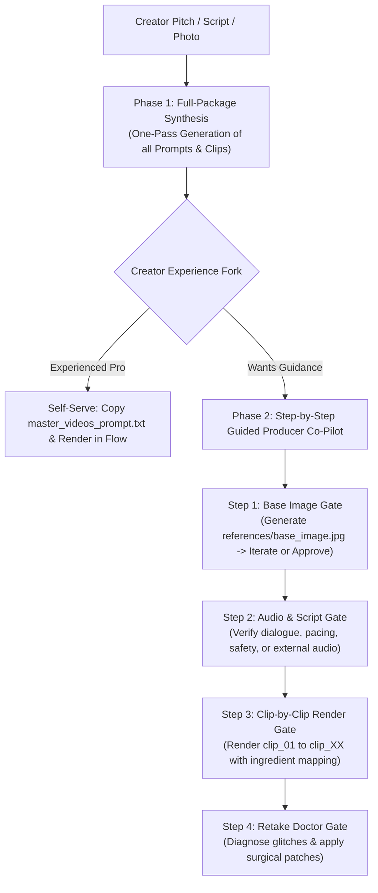

# Discussion 65 — Phase 07: Universal Production Scaffolding & The Guided Co-Producer Experience

## 1. Context & Architectural Milestone
Following the empirical certification of **Phase 6: Director's Cut & Assembly** (empirically tested on Google Flow Veo 3.1 in the *Sarcastic Trading Explainer* simulation), the project enters **Phase 7: Project Scaffolding**.

The objective of Phase 7 is to design and codify the canonical template directory (`production_template/`) that serves as:
1. The deterministic project blueprint cloned by the upcoming Node.js/CLI tooling (`OpenProducer` / `npx openproducer init`).
2. The living operational workspace used by AI Agents and human creators during interactive video production.

---

## 2. Core Architectural Breakthroughs

### Breakthrough 1: The Producer Boundary (Agent Directs, Creator Renders)
* **The AI Agent is the Director & Executive Producer**, not a video rendering engine.
* The Agent:
  * Formulates pristine, machine-grade prompts (Tier 1 Base Image, Tier 2 Start Frames, Tier 3 Veo Kinematics).
  * Injects technical anchors, camera perspectives, negative prompts, acoustic bridges, and motion graphics.
  * Prescribes exact usage instructions for Google Flow (aspect ratio, resolution, ingredient references).
  * Acts as the **Retake Doctor** to diagnose and surgically patch model glitches (speech repetition, dead air, text spoilers).
* **The Creator** owns their accounts, compute credits, and final creative approval.

### Breakthrough 2: The OpenSpec Separation (`openproducer/` Engine Room)
To prevent overwhelming creators with complex technical markdown files, the project strictly bifurcates into:
1. **Creator-Facing Assets (Project Root):**
   * High-signal, clean, intuitive files that creators actually touch and copy:
     * `base_image_prompt.txt`
     * `references/` (creator photo and generated base reference)
     * `clips/` (`clip_01/video_prompt.txt`, etc.)
     * `master_videos_prompt.txt` (1-click clipboard for Google Flow)
     * `scratchbook.md` (timeline budget, script, retake notes)
     * `motion_graphics.md` (on-screen captions & typography)
2. **Producer Engine Room (`openproducer/` — No Leading Dot):**
   * Visible, accessible directory containing the Agent's internal deterministic context:
     * `config.json` (Archetype, Aspect Ratio, Flow model, Audio Pathway)
     * `state.json` (Tracks active production stage & lock status)
     * `blueprint.md` (Chronological collaboration log)
     * `manifest.json` (Audit trail for Master Linters L-01 to L-19)
     * `visual/`, `subjects/`, `environments/` (Deep technical specs, biometrics, spatial planes)

### Breakthrough 3: Two-Tier Elastic Scaffolding
* **Tier 1: Lean / Base-Reference (80% of Productions):**
  * Social Reels (TikTok/Instagram), Solo Explainers, 2D Stick-Figure animations, Tabletop commercials.
  * Uses a single **`base_image_prompt.txt`** to generate `references/base_image.jpg`.
  * That single image locks the character face, clothing, room lighting, and visual style simultaneously.
  * Every clip references `[IMAGE 1]: references/base_image.jpg`.
* **Tier 2: Modular Studio (Cinematic & Multi-Scene):**
  * Multi-character short films, episodic drama, multi-location stories.
  * Birthed from a **Genesis Master Style Plate** (`genesis_style.jpg`) so character turnarounds and empty stage plates inherit identical visual DNA without style drift.

---

## 3. The 2-Phase Creator Experience Flow



### Detailed Phase Breakdown:

#### Phase 1: Total Generation (The "Full Package" First)
* The Agent does **not** stop after every small file to ask 20 tedious questions.
* In one pass, the Agent synthesizes the complete draft:
  * Base image prompt (`base_image_prompt.txt`)
  * Script breakdown and 4s/6s/8s pacing budget (`scratchbook.md`)
  * All clip prompts (`clips/clip_01/` to `clip_XX/`)
  * Master compilation (`master_videos_prompt.txt`)
  * Engine metadata inside `openproducer/`
* *The Decision Fork:* The Agent presents the completed draft and asks:
  > *"Your complete production package is ready! Would you like me to walk you through a **Step-by-Step Guided Run** to test and lock your Base Image and Audio first, or do you want to handle the rendering yourself?"*

#### Phase 2: The Step-by-Step Guided Run (The Beginner Co-Pilot)
1. **Step 1: The Base Image Gate:**
   * Agent presents `base_image_prompt.txt` with instructions for Google Flow / Imagen.
   * Creator generates `references/base_image.jpg`.
   * Feedback loop: If creator wants changes (hair, lighting, wardrobe, room), Agent updates the prompt and repeats until approved.
2. **Step 2: The Audio & Script Gate:**
   * Agent verifies dialogue pacing, L-19 safety, and audio bridges. If external voice is used, creator provides audio/transcript. Agent cascades changes into clip prompts.
3. **Step 3: The Clip-by-Clip Render Gate:**
   * Agent walks creator through rendering each clip prompt sequentially with exact Flow ingredient bindings.
4. **Step 4: The Retake Doctor Gate:**
   * Agent diagnoses any runtime AI glitches (speech looping, dead air, text spoilers) and prescribes surgical patches.

---

## 4. State Tracking Specification (`openproducer/state.json`)

To ensure session persistence across workstations and IDE reloads, `openproducer/state.json` tracks progress:

```json
{
  "project_name": "trading_sarcasm",
  "archetype": "social_ugc",
  "aspect_ratio": "9:16",
  "resolution": "1080p",
  "audio_pathway": "native_veo",
  "tier": "lean_base_reference",
  "current_stage": "base_image_review",
  "stages": {
    "synthesis_complete": true,
    "base_image_locked": false,
    "audio_script_locked": false,
    "clips_rendered": false,
    "assembly_complete": false
  },
  "created_at": "2026-10-28T13:15:00Z",
  "updated_at": "2026-10-28T13:15:00Z"
}
```

---

## 5. Next Steps
* Scaffold canonical template directory `production_template/` adhering to this specification.
* Update `AGENTS.md` roadmap to track Phase 7 implementation.
