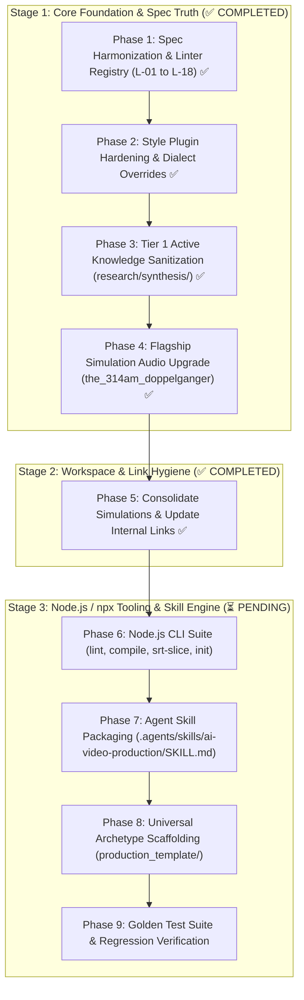

# God-Tier AI Video Generation Skill: Master Execution Plan

**Location:** [`discussions/docs/god_tier_skill_plan.md`](file:///d:/Modasser_Workspace/research/video-generation-skill/discussions/docs/god_tier_skill_plan.md)  
**Date:** October 27, 2026  
**Target Platform:** Google Flow (Veo 3.1, Imagen 4, Gemini Omni Flash, Gemini 3.8 Flash TTS)  
**Tooling Runtime:** Node.js / `npx` CLI (`@theprojectsx/video-skill`)  
**Status:** Living Execution Blueprint  

---

## 1. Executive Summary & Strategy Pivot

Per the latest architectural consensus, we are deliberately sequencing our work to **fix the core foundation first** before building file scaffolding and linting automation.

Building tooling on top of conflicting specifications or un-sanitized prompt research creates brittle linters that fight each other. Therefore, our execution is strictly staged into:
1. **Foundational Content & Rule Harmonization** (Phases 1–4): Eliminate all spec contradictions, complete style plugins, purge outdated research anti-patterns, and upgrade benchmark simulations.
2. **Workspace & Link Hygiene** (Phase 5): Consolidate legacy simulation folders and update all internal links.
3. **Node.js / `npx` Automation Suite** (Phase 6): Build the zero-dependency CLI tooling in Node.js so anyone can run `npx video-skill lint` or `npx video-skill compile`.
4. **Skill Engine Packaging & Archetype Scaffolding** (Phases 7–9): Package the skill into `.agents/skills/ai-video-production/SKILL.md` and verify against golden benchmarks.



---

## 2. Detailed Step-by-Step Implementation

### Phase 1: Specification Harmonization & Canonical File Contracts (✅ COMPLETED)
*Objective: Eliminate all internal contradictions, conflicting linter IDs, and vocabulary bugs across authoritative specs.*

1. **Establish the Unified 18-Rule Linter Registry (`L-01` to `L-18`):**
   - Harmonize [`00_architecture_blueprint.md`](file:///d:/Modasser_Workspace/research/video-generation-skill/production_framework/00_architecture_blueprint.md), [`03_scenery_spec.md`](file:///d:/Modasser_Workspace/research/video-generation-skill/production_framework/specs/03_scenery_spec.md), [`04_cinematography_audio_spec.md`](file:///d:/Modasser_Workspace/research/video-generation-skill/production_framework/specs/04_cinematography_audio_spec.md), and [`05_directors_cut_assembly_spec.md`](file:///d:/Modasser_Workspace/research/video-generation-skill/production_framework/specs/05_directors_cut_assembly_spec.md) to reference this single registry:
     - **`L-01` Word Economy:** `100–150 words` for Standalone Text-to-Video; **`75–150 words` for Tier 3 Image-to-Video (`video_prompt.txt`)**. Word count excludes `[CONFIGURATION SETTINGS]` and `NEGATIVE PROMPT:` clauses.
     - **`L-02` Attention Front-Loading:** Viewport framing and primary subject anchor appear within Tokens 1–30.
     - **`L-03` Equipment Noun Ban:** Banned hardware nouns (`tripod`, `dolly`, `crane`, `jib`, `rig`, `drone`, `gimbal`, `steadicam`, `slider`, `camera body`). **Positive prompts only; negative prompts exempt.**
     - **`L-04` Config Decoupling:** Technical specs (`16:9`, `9:16`, `4:3`, `1080p`, `720p`, `4K`, `24fps`, `60fps`, `320x240`) banned from creative prompt prose. **Artistic cadence tokens (`12fps`, `on twos`, `hand-cranked 16fps silent film`) whitelisted.**
     - **`L-05` Anti-Subtitle & Non-Render Guardrail:** Narrative context uses `(REFERENCE ONLY — DO NOT RENDER...)` and negative prompt includes anti-subtitle tokens.
     - **`L-06` Subject DNA vs. Lean Reference Anchor:** Text-conditioned clips inject verbatim anchor; `[IMAGE 1]`-conditioned prompts use Lean Reference Anchoring (`The exact same person from [IMAGE 1]...`) banning competing bone-structure text.
     - **`L-07` Pre-Materialized Prop & Closed-Set Bounds:** Held props declared grasped from Frame 1 to Frame End (no mid-clip drawing).
     - **`L-08` Empty Stage & 3-Plane Environment:** Environment reference plates (`Ingredient #2`) contain zero people/hero products; scenes establish Foreground, Midground, Background.
     - **`L-09` Flow Native Duration Lock:** Clip durations in Flow Native mode strictly in `{4s, 6s, 8s, 10s}`.
     - **`L-10` Single-Motion De-Cramming & Clock Bracket Ban:** Strictly 1 primary action, 1 spatial plane, 1 continuous camera trajectory. Numeric clock brackets (`\[\d{2}:\d{2}`) banned; natural temporal phrases (`"For the first two seconds..."`) permitted.
     - **`L-11` Continuity Chaining Syntax:** Mode 1 extensions begin with `"Continuing directly from the initial frame..."`; Tier 3 I2V begins with `"Starting directly from the initial image..."`.
     - **`L-12` 30° Contrast & Anti-Jump-Cut:** Consecutive cuts of same subject must shift angle by $\ge 30^\circ$, change shot scale, or chain via `last_frame`.
     - **`L-13` 180° Screen Direction & Clean Singles (OTS Ban):** Conversational cuts preserve complementary 15° eyelines and use Clean Singles (**dirty OTS shots strictly banned**).
     - **`L-14` Dual-Track Speech Word Budget & Silence Buffer:**
       - Native Flow (`Pathway A`): $\le \{5, 9, 13, 18\}$ words for $\{4\text{s}, 6\text{s}, 8\text{s}, 10\text{s}\}$.
       - External TTS (`Pathway B`): $\le \{8, 12, 18, 22\}$ words; $\text{Clip Duration} - \text{SRT Cue Duration} \ge 1.0\text{s}$ total silence buffer ($\ge 0.4\text{s}$ pre-roll, $\ge 0.6\text{s}$ post-roll).
     - **`L-15` Anti-Muppet Restraint & Phonetic Normalization:** Spoken lines use preceding colon (`says, [modifier]: "..."`), strict sentence case (no ALL CAPS words), $\ge 2$ restraint tokens (`relaxed jaw, minimal jaw displacement, subtle lip articulation`), and mandatory phonetic word expansion for digits/symbols/acronyms in Pathway A (`"three fourteen"`, `"twenty-four frames"`).
     - **`L-16` Closed-Lip Listener Rule:** Off-screen/phone/narrator speech while a character's face is visible mandates `firmly closed lips, tight jaw, zero mouth movement`.
     - **`L-17` Structured 4-Field Audio Syntax:** Trailing audio follows `Audio: SFX: ...; Ambience: ...; Dialogue: ...; Music: ...` with music suppression over dialogue.
     - **`L-18` Gemini TTS Script Formatting & Non-Imposition Law:** `narrator_script.md` isolates `< >` tags on standalone lines (`.\n<long pause>\n`), bans `[...]` brackets, and never rewrites creator's authored voice into 2nd person.

2. **Harmonize `02_character_spec.md` Scenario 1 Contradiction:**
   - Delineate between **Workflow 1A (Text-Only Genesis)**: inject full anatomical landmarks (zygomatic arches, nose bridge) vs. **Workflow 1B (Image-Conditioned Production)**: apply Rule 9 Lean Reference Anchoring (`The exact same person from [IMAGE 1]...`) to avoid competing token attention.

3. **Harmonize `05_directors_cut_assembly_spec.md` Durations & Headers:**
   - Replace Section 2.1 table with the validated Pathway A Veo speech velocity limits (`4s = 3–5w`, `6s = 7–9w`, `8s = 11–13w`, `10s = 15–18w`).
   - Clarify Section 4.4 4-Beat rhythm as timeline/editorial micro-beats mapping to Flow `4s` and `6s` blocks.
   - Fix line 302 typo (`5s` $\rightarrow$ `4s/6s/8s/10s`).
   - Deprecate Section 7.1 legacy format and lock canonical `.txt` headers:
     - `image_prompt.txt`: `[IMAGE CONFIGURATION]`, `[IMAGE PROMPT]`, `[NEGATIVE PROMPT]`
     - `video_prompt.txt`: `[CONFIGURATION SETTINGS]`, `[VIDEO PROMPT]`, `[NEGATIVE PROMPT]`

4. **Propagate OTS Ban & Optical Recipe Cleanup in `04_cinematography_audio_spec.md`:**
   - Purge OTS from line 32.
   - In Section 2.3 recipes, replace `crane-up` with `upward elevation sweep` and `dolly zoom` with `optical contra-zoom (zolly) vertigo effect`.

5. **Connect `01_visual_spec.md` to `production_framework/styles/`:**
   - Add `vector_stick_figure` to Section 4 Master Style table and link to the 3-Tier Medium $\rightarrow$ Dialect $\rightarrow$ Scene Mood inheritance architecture.

---

### Phase 2: Pluggable Style Registry Hardening (`production_framework/styles/`) (✅ COMPLETED)
*Objective: Ensure all 8 style plugins are complete, structurally uniform, and 100% compliant with pre-flight linters.*

1. **Complete [`vector_stick_figure.md`](file:///d:/Modasser_Workspace/research/video-generation-skill/production_framework/styles/vector_stick_figure.md):**
   - Expand to the full 7-section layout.
   - Integrate the 4 verified dialects: `minimalist_noir`, `kurzgesagt_infographic`, `action_smear_xiao_xiao`, and `anatomical_stick_with_hands`.
   - Add explicit **Dialect Negative Override** for `anatomical_stick_with_hands` (removing `individual fingers` from base negative and replacing with `fleshy human skin, fingernails, organic knuckles`).
   - Add Section 6 Native Audio Foley soundboard in semicolon format.

2. **Restructure [`social_ugc_video.md`](file:///d:/Modasser_Workspace/research/video-generation-skill/production_framework/styles/social_ugc_video.md):**
   - Renumber to 7 sections (Section 6 = Audio, Section 7 = Negative Prompt).
   - Purge `9:16` and `4K` from positive anchor strings.

3. **Sanitize Positive Anchors Across All Style Plugins:**
   - [`live_action_cinema.md`](file:///d:/Modasser_Workspace/research/video-generation-skill/production_framework/styles/live_action_cinema.md): Replace `drone` with `aerial sweeping glide`.
   - [`vintage_retro_film.md`](file:///d:/Modasser_Workspace/research/video-generation-skill/production_framework/styles/vintage_retro_film.md): Replace `crane-like` with `elevated sweeping`, replace `[OCT 24 1987]` with `natural period CRT display artifacts`, and remove `4:3`.
   - [`stylized_3d_cgi.md`](file:///d:/Modasser_Workspace/research/video-generation-skill/production_framework/styles/stylized_3d_cgi.md): Replace `320x240` with `crunchy retro low-polygon rasterized rendering`.
   - [`traditional_2d_anime.md`](file:///d:/Modasser_Workspace/research/video-generation-skill/production_framework/styles/traditional_2d_anime.md): Replace `24fps` with `stepped animation cadence on twos`.

4. **Upgrade Style Plugin Audio Sections to Semicolon Syntax:**
   - Standardize Section 6 in all 8 plugin files to `Audio: SFX: ...; Ambience: ...; Dialogue: ...; Music: ...`.

---

### Phase 3: Active Knowledge Base Sanitization (`research/synthesis/`) (✅ COMPLETED)
*Objective: Cleanse Tier 1 Active Knowledge of Phase 1–4 anti-patterns so agent reasoning is never contaminated.*

1. **Sanitize Prompt Anatomy & Cinematography Files:**
   - [`02_prompt_anatomy.md`](file:///d:/Modasser_Workspace/research/video-generation-skill/research/synthesis/02_prompt_anatomy.md): Replace `tripod` and `dolly-in` with pure kinematic vectors.
   - [`03_prompt_techniques.md`](file:///d:/Modasser_Workspace/research/video-generation-skill/research/synthesis/03_prompt_techniques.md): Purge `[00:00-00:03]` timestamps; replace `locked tripod`, `Crane / Jib`, `Steadicam`, and `FPV Drone`.
   - [`04_character_and_consistency.md`](file:///d:/Modasser_Workspace/research/video-generation-skill/research/synthesis/04_character_and_consistency.md): Update to **4-Panel Turnaround on `#E5E5E5`**; remove `locked tripod`.
   - [`05_multi_clip_and_storyboard.md`](file:///d:/Modasser_Workspace/research/video-generation-skill/research/synthesis/05_multi_clip_and_storyboard.md): Replace `5s` with `4s/6s`; remove `Steadicam`; purge `"16:9, 1080p, 24fps, 8s."`.
   - [`06_audio_and_dialogue.md`](file:///d:/Modasser_Workspace/research/video-generation-skill/research/synthesis/06_audio_and_dialogue.md): Replace OTS with Clean Singles; inject Anti-Muppet biomechanical restraints; purge config specs from prompt strings.
   - [`07_structured_prompting.md`](file:///d:/Modasser_Workspace/research/video-generation-skill/research/synthesis/07_structured_prompting.md): Add `10s` duration; purge inline config appending from `compile_veo_prompt()`; link to `L-01`–`L-18` registry.
   - [`09_prompt_examples.md`](file:///d:/Modasser_Workspace/research/video-generation-skill/research/synthesis/09_prompt_examples.md): Strip technical spec trailers; replace `locked on tripod`; add mouth restraints to dialogue prompts.
   - [`01_api_and_models.md`](file:///d:/Modasser_Workspace/research/video-generation-skill/research/synthesis/01_api_and_models.md) & [`validation.md`](file:///d:/Modasser_Workspace/research/video-generation-skill/research/validation.md): Add `10s` to supported Flow durations.

2. **Add Authority Banner to `research/styles/`:**
   - Mark `research/styles/` as historical reference, directing compiler agents to `production_framework/styles/`.

---

### Phase 4: Flagship Simulation Audio Upgrade (*The 3:14 AM Doppelgänger*) (✅ COMPLETED)
*Objective: Bring our flagship reference production to 100% compliance with Linter `L-17`/`L-18`.*

1. **Update Trailing Audio Blocks:**
   - Convert all 22 clip audio lines in [`the_314am_doppelganger/clips/clip_XX/video_prompt.txt`](file:///d:/Modasser_Workspace/research/video-generation-skill/production_framework/simulations/the_314am_doppelganger/clips/) and [`master_videos_prompt.txt`](file:///d:/Modasser_Workspace/research/video-generation-skill/production_framework/simulations/the_314am_doppelganger/master_videos_prompt.txt) to:
     ```text
     Audio: SFX: [Precise Foley]; Ambience: [Subtle room tone / silence]; Dialogue: None; Music: None.
     ```

---

### Phase 5: Workspace & Link Hygiene (✅ COMPLETED)
*Objective: Consolidate scattered simulation folders and preserve 100% link integrity.*

1. **Move Top-Level Simulation Folders:**
   - Move `directors_cut/`, `stick_figure_horror/`, `rat_race_stick_figure/`, `the_phone_call_at_247am/`, and `the_314am_doppelganger/` into `production_framework/simulations/`.

2. **Atomically Update Internal Links:**
   - Update all 14 internal links across:
     - [`AGENTS.md`](file:///d:/Modasser_Workspace/research/video-generation-skill/AGENTS.md) (Lines 35, 331, 342, 348, 357, 424, 429, 507)
     - [`05_directors_cut_assembly_spec.md`](file:///d:/Modasser_Workspace/research/video-generation-skill/production_framework/specs/05_directors_cut_assembly_spec.md) (Lines 11, 426)
     - [`discussions/directors_cut_and_assembly.md`](file:///d:/Modasser_Workspace/research/video-generation-skill/discussions/directors_cut_and_assembly.md) (Lines 11, 104)

3. **Update `AGENTS.md` Bookkeeping:**
   - Update raw log file count from `27` to `57+`.
   - Update Phase 8 roadmap entry from `Linters (L-01 to L-11)` to `Linters (L-01 to L-18)`.
   - Remove dead links to deleted `dump.md` (Lines 382, 490, 517).
   - Update Section 6 status header from `UNDER DEVELOPMENT` to `COMPLETED & VALIDATED`.

---

### Phase 6: Node.js / `npx` Automation Suite (`tools/cli/` or `packages/cli/`)
*Objective: Build an ultrafast, zero-dependency Node.js CLI executable directly via `npx`.*

We will create the CLI package with `package.json` (`"bin": { "video-skill": "./bin/cli.js" }`):

```text
tools/cli/
├── bin/
│   └── cli.js                     # Main executable entry point
├── src/
│   ├── index.ts                   # Core API exports
│   ├── linter/
│   │   ├── engine.ts              # AST section parser & rule runner
│   │   ├── rules/                 # Isolated rules L-01 to L-18
│   │   └── reporter.ts            # Colored ANSI terminal reporter & JSON output
│   ├── compiler/
│   │   ├── compile-production.ts  # clips/ <-> master_*.txt bidirectional sync
│   │   └── parser.ts              # Canonical header parser
│   ├── slicer/
│   │   ├── srt-parser.ts          # SRT timestamp & WPS velocity calculator
│   │   └── scratchbook-gen.ts     # Flow [4s, 6s, 8s, 10s] slicing engine
│   └── template/
│       └── hydrator.ts            # Archetype project scaffolder
└── package.json
```

#### CLI Capabilities:
- `npx video-skill lint [--project <dir>] [--fix]`:
  - Isolates prompt sections; exempts `NEGATIVE PROMPT:` and `[CONFIGURATION SETTINGS]`.
  - Enforces `75–150 words` for Tier 3 I2V; `100–150 words` for standalone T2V.
  - Whitelists creative cadence (`12fps`, `on twos`).
  - Strict word boundaries on hardware nouns.
  - Supports `<!-- lint-ignore L-XX -->` escape hatches.
- `npx video-skill compile [--project <dir>] [--split]`:
  - Compiles `clips/clip_XX/*.txt` into `master_images_prompt.txt` and `master_videos_prompt.txt`.
  - With `--split`, takes edited master prompt files and updates atomic clip subfolders.
- `npx video-skill slice <audio.srt> [--duration 60]`:
  - Calculates cue durations and proposes mathematical `scratchbook.md` with $\ge 1.0\text{s}$ buffers.
- `npx video-skill init <name> --style <medium> --archetype <cinema|commercial|ugc|stick|anime>`:
  - Scaffolds a project instantly.

---

### Phase 7: The "God-Tier" Agent Skill Engine (`SKILL.md`)
*Objective: Package the framework into a native Antigravity / Agent Skill (`.agents/skills/ai-video-production/SKILL.md`).*

Encapsulate the 6 operational modes:
1. `mode: explore` — Style DNA, Base Medium/Dialect selection, Non-Imposition Law.
2. `mode: script_and_slice` — Automated SRT/Script pacing via `npx video-skill slice`.
3. `mode: scaffold` — Workspace generation, 2-Step Angle Normalizer, 1:7.5 scale ratio lock.
4. `mode: compile` — Tier 1, Tier 2, Tier 3 prompts assembled into Dual Decoupled Master Prompts.
5. `mode: lint` — Autonomous pre-flight check via `npx video-skill lint` with self-healing auto-fix.
6. `mode: sync` — Bidirectional sync between master manifests and clip subfolders.

---

### Phase 8: Universal Archetype Scaffolding (`production_template/`)
*Objective: Provide zero-friction boilerplate templates for the 5 primary video mediums.*

Build `production_framework/production_template/` with 5 pre-configured presets:
1. `cinema_narrative` (35mm film, 15° eyelines, Clean Singles, atmospheric room tone).
2. `commercial_tabletop` (100mm macro, metallic rim lighting, product turntable sheets on `#E5E5E5`).
3. `social_ugc_mobile` (Vertical 9:16, eye-level direct address, domestic acoustics, dynamic hooks).
4. `vector_stick_figure` (Clean 2D vector minimalism, fingerless line anatomy, whiteboard SFX).
5. `traditional_2d_anime` (Cel shading, stepped 12fps timing on twos, cosplay fabric translation).

---

### Phase 9: Golden Test Suite & End-to-End Verification
*Objective: Automated regression guard ensuring 100% reliability across all reference projects.*

1. **Verify Flagship Simulation:**
   - Run `npx video-skill lint --project simulations/the_314am_doppelganger`.
   - Assert: **22 of 22 clips pass all 18 linters (100% Score)**.
2. **Remediate & Verify Negative Test Case (*software_framework_intro*):**
   - Apply Lean Reference Anchors, trim dialogue word counts to native Veo budgets, and enforce 30° contrast cuts.
   - Assert: Previously failing simulation passes 100%.
3. **Verify Bidirectional Compiler:**
   - Assert byte-for-byte fidelity when compiling clips $\rightarrow$ master manifests and splitting back $\rightarrow$ clips.
4. **Final Sign-Off:**
   - Update [`production_framework/00_tasks.md`](file:///d:/Modasser_Workspace/research/video-generation-skill/production_framework/00_tasks.md) and [`AGENTS.md`](file:///d:/Modasser_Workspace/research/video-generation-skill/AGENTS.md) marking all milestones completed.

---

## 3. Immediate Next Action

We are ready to begin **Phase 1: Specification Harmonization & Canonical Contracts**:
- Harmonize the unified `L-01` to `L-18` Registry across specs.
- Resolve the biometrics vs. Lean Reference Anchor contradiction in `02_character_spec.md`.
- Fix the duration and word-budget tables in `05_directors_cut_assembly_spec.md`.
- Purge OTS and clean optical recipes in `04_cinematography_audio_spec.md`.
