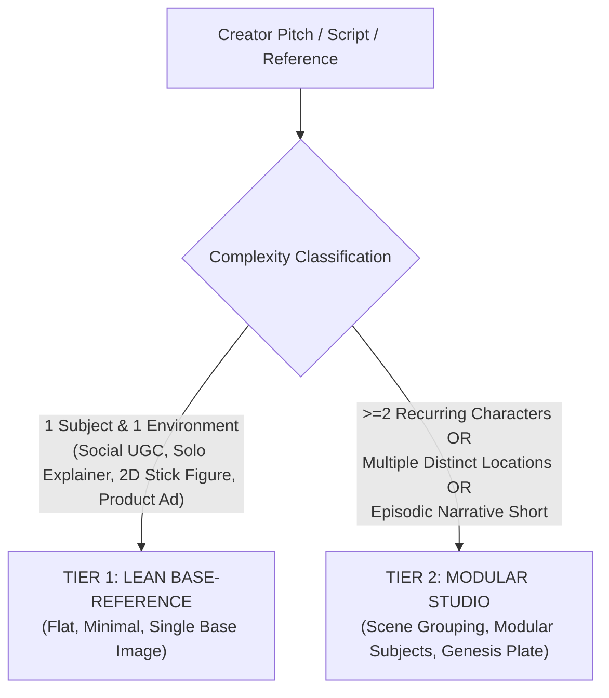
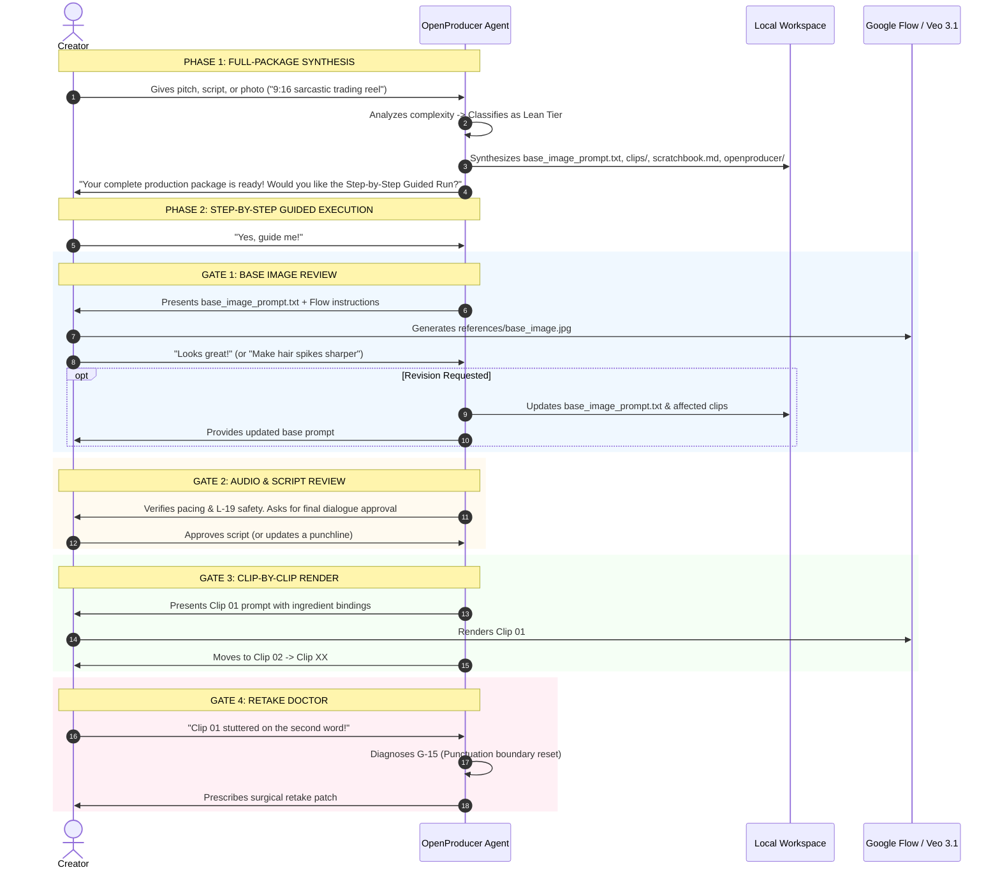

# Specification 07: Dynamic Workspace Scaffolding & The 2-Phase Guided Producer Engine

## 1. Architectural Philosophy: The Dynamic Generator Paradigm

In OpenProducer, **we do not copy static template folders containing dummy placeholder text**. Static templates burden creators with placeholder cleanup and force rigid assumptions (e.g. fixed 4 clips, dummy characters, generic dialogue).

Instead, OpenProducer operates on the **Dynamic Generator Paradigm**:
1. The **AI Agent is the Executive Producer & Director**. It holds the complete architectural knowledge and prompt-engineering mechanics in its skill brain.
2. During initial intake, the Agent analyzes the creator's creative pitch, script, or photo.
3. The Agent **classifies the project tier** (Lean vs. Studio) and **dynamically synthesizes the exact, custom-tailored workspace directly on disk**—with real characters, tailored cinematography, accurate duration budgets, and zero dummy boilerplate.
4. The Agent then presents a **2-Phase Creator Experience**: a one-pass full package draft followed by an interactive, step-by-step guided review.

---

## 2. Project Tier Classification Logic

The Agent automatically evaluates project complexity based on creator input and selects one of two operating tiers:



### Classification Rules:
| Project Trait | Assigned Tier | Scaffolding Behavior |
|---|---|---|
| Single host/creator in one studio/room | **Lean Tier** | Single `base_image_prompt.txt` locks face + studio together. No `subjects/` or `environments/` folders created. |
| 2D animation / Stick Figure explainer | **Lean Tier** | Single `base_image_prompt.txt` locks art style + canvas. Flat `clips/` directory. |
| Tabletop commercial product (watch, shoe) | **Lean Tier** | Single `base_image_prompt.txt` locks lighting + product hero. Flat `clips/` directory. |
| Short film with 2+ actors interacting | **Studio Tier** | Generates `openproducer/subjects/<id>/` for each actor; clips use multi-character clean singles. |
| Story moving across multiple locations | **Studio Tier** | Generates `openproducer/environments/<id>/` for each stage plate. |
| Multi-scene episodic narrative | **Studio Tier** | Clips grouped into `clips/scene_01/`, `clips/scene_02/`. |

---

## 3. Directory Layout Contracts

### 3.1 Tier 1: Lean Base-Reference Workspace
*Optimized for speed, simplicity, and zero friction. The creator sees only what they need to execute.*

```text
<project_root>/
├── openproducer/                  # THE PRODUCER ENGINE ROOM (Agent Context)
│   ├── config.json                # Project configuration & model settings
│   ├── state.json                 # Interactive production stage tracker
│   ├── blueprint.md               # Chronological collaboration log & decisions
│   ├── manifest.json              # Pre-flight audit ledger for Linters L-01 to L-19
│   └── visual/
│       └── technical_anchor.txt   # The master 30-word visual style anchor string
│
├── base_image_prompt.txt          # CREATOR ASSET: Tier 1 prompt to generate base_image.jpg
├── references/                    # CREATOR ASSET: Visual assets directory
│   ├── creator_photo.jpg          # (Input) Real photo, sketch, or mood reference
│   └── base_image.jpg             # (Output from Gate 1) Master Ingredient #1 for Flow
│
├── clips/                         # CREATOR ASSET: The shot prompts
│   ├── clip_01/
│   │   ├── image_prompt.txt       # Tier 2: Starting posture/framing
│   │   └── video_prompt.txt       # Tier 3: Action, dialogue, cinematography, audio
│   ├── clip_02/
│   │   └── video_prompt.txt
│   └── clip_XX/
│
├── master_videos_prompt.txt       # CREATOR ASSET: 1-click clipboard for Google Flow
├── scratchbook.md                 # CREATOR ASSET: Script pacing table (4s/6s/8s) & retake log
└── motion_graphics.md             # CREATOR ASSET: On-screen caption & subtitle cue sheet
```

---

### 3.2 Tier 2: Modular Studio Workspace
*Activated for multi-character, multi-scene narrative productions. Keeps the creator root uncluttered while storing deep character bibles and stage plates inside `openproducer/`.*

```text
<project_root>/
├── openproducer/                  # THE PRODUCER ENGINE ROOM
│   ├── config.json                # Tier: "modular_studio", Aspect: "16:9", Cinema
│   ├── state.json                 # State tracker with scene completion metrics
│   ├── blueprint.md               # Director's screenplay notes & character arcs
│   ├── manifest.json              # Pre-flight audit ledger (L-01 to L-19)
│   │
│   ├── visual/                    # Master Visual DNA
│   │   ├── technical_anchor.txt   # Master style anchor string
│   │   └── genesis_prompt.txt     # Generates genesis_style.jpg to anchor all assets
│   │
│   ├── subjects/                  # Modular Cast & Hero Props
│   │   ├── <subject_a_id>/
│   │   │   ├── profile.md         # Facial biometrics, wardrobe, voice profile
│   │   │   ├── hero_prompt.txt    # Step 1 Hero shot (conditioned on genesis_style.jpg)
│   │   │   └── turnaround.jpg     # Step 2: 4-view model sheet (Ingredient for Flow)
│   │   └── <subject_b_id>/
│   │       ├── profile.md
│   │       ├── hero_prompt.txt
│   │       └── turnaround.jpg
│   │
│   └── environments/              # Modular Stages (Empty 3-Plane Plates)
│       ├── <env_a_id>/
│       │   ├── summary.md         # Spatial depth, lighting rig, acoustics
│       │   └── plate.jpg          # Empty stage plate (conditioned on genesis_style.jpg)
│       └── <env_b_id>/
│           ├── summary.md
│           └── plate.jpg
│
├── references/
│   └── genesis_style.jpg          # Master Visual DNA Reference
│
├── clips/                         # The Shots Grouped by Scene
│   ├── scene_01_<name>/
│   │   ├── clip_01/
│   │   │   └── video_prompt.txt   # Ingredients: [IMAGE 1]=subject_a, [IMAGE 2]=env_a
│   │   └── clip_02/
│   │       └── video_prompt.txt   # Clean single of subject_b
│   └── scene_02_<name>/
│       ├── clip_03/
│       │   └── video_prompt.txt   # Ingredients: [IMAGE 1]=subject_a, [IMAGE 2]=env_b
│       └── clip_04/
│
├── master_videos_prompt.txt       # Master compilation grouped by scene with ingredient maps
├── scratchbook.md                 # Screenplay timeline, eyeline vectors, acoustic bridges
└── motion_graphics.md             # Title cards, lower thirds, subtitle cue sheet
```

---

## 4. Exact File Content Contracts & Schemas

### 4.1 `openproducer/config.json` Schema
```json
{
  "project_name": "<project_slug>",
  "archetype": "social_ugc | cinematic | commercial | documentary | animation",
  "tier": "lean_base_reference | modular_studio",
  "aspect_ratio": "9:16 | 16:9 | 1:1",
  "resolution": "1080p | 4k",
  "target_duration_seconds": 24,
  "flow_orchestration": {
    "video_model": "veo-3.1",
    "image_model": "imagen-4",
    "director_model": "gemini-1.5-pro"
  },
  "audio_pathway": "pathway_a_native_veo | pathway_b_external_audio_lipsync",
  "language": "bn-BD | en-US | etc",
  "linter_profile": "strict"
}
```

---

### 4.2 `openproducer/state.json` Schema
```json
{
  "project_name": "<project_slug>",
  "tier": "lean_base_reference",
  "current_stage": "intake_complete | base_image_review | audio_review | clip_rendering | retake_doctor | completed",
  "stages": {
    "synthesis_complete": true,
    "base_image_locked": false,
    "audio_script_locked": false,
    "clips_rendered": false,
    "assembly_complete": false
  },
  "interactive_guidance": {
    "enabled": true,
    "active_gate": 1,
    "gate_name": "base_image_review"
  },
  "created_at": "ISO-8601 Timestamp",
  "updated_at": "ISO-8601 Timestamp"
}
```

---

### 4.3 `base_image_prompt.txt` Structure Contract
```text
================================================================================
TIER 1: MASTER BASE REFERENCE IMAGE PROMPT
================================================================================
[IMAGE CONFIGURATION]
Aspect Ratio: <9:16 | 16:9>
Resolution: 1080p
Conditioning: [IMAGE 1] (Creator Reference Photo in references/creator_photo.jpg)
Output Asset: references/base_image.jpg

[IMAGE PROMPT]
<Cinematic framing, subject identity, facial landmark locks, wardrobe materiality, environment spatial depth, lighting vectors, and visual style anchor string. 100% pure cinema description, zero equipment nouns.>

[NEGATIVE PROMPT]
<blurry, cartoon, 3D render, anime, altered facial features, shifted skin tone, graphic logos on shirt, cluttered background, harsh direct flash, over-saturation, watermarks, text.>
```

---

### 4.4 `clips/clip_XX/video_prompt.txt` Structure Contract
```text
================================================================================
TIER 3: CLIP <XX> VIDEO GENERATION PROMPT
================================================================================
[CONFIGURATION SETTINGS]
Aspect Ratio: <9:16 | 16:9>
Resolution: 1080p
Duration: <4 | 6 | 8> seconds
Model: Veo 3.1
Ingredient References:
- [IMAGE 1]: references/base_image.jpg (Master Identity & Setting Lock)

[VIDEO PROMPT]
<Tokens 1-30: Viewport framing & subject anchor (L-04, L-15).
Tokens 31-80: Biomechanical action & motivated lighting (L-10, L-12).
Tokens 81-130: Injected visual style anchor (L-18) & single camera verb (L-05).
Tokens 131-150: Spoken dialogue with soft punctuation (G-15) and trailing audio closure (L-06, L-17).
Strict Word Economy: 75-150 words (L-01). Zero equipment nouns (L-02).>

[NEGATIVE PROMPT]
<camera equipment, tripod, dolly track, blurry, cartoon, 3D render, morphing face, distorted hands, extra fingers, text, subtitles, watermark, speech looping, unnatural pauses, background music.>

[AUDIO SPECIFICATION]
Vocal Delivery: <Pacing, tone, and onset timing (Immediate Vocal Attack for UGC, G-16).>
Dialogue: "<Exact dialogue string with soft punctuation dots/commas (G-15).>"
Acoustics: <Acoustic signature, microphone intimacy, natural room tone (L-13).>
Acoustic Bridge: <Transition tail and reverb decay bridging into next clip (L-17).>
```

---

## 5. The 2-Phase Creator Experience Engine



---

## 6. Session Persistence & Handoff Protocol

Any AI agent entering an OpenProducer workspace—regardless of workstation, device, or IDE—must execute the following startup sequence:
1. **Read `openproducer/config.json`:** Identifies archetype, aspect ratio, audio pathway, and project tier.
2. **Read `openproducer/state.json`:** Identifies `current_stage` and `active_gate`.
3. **Read `openproducer/blueprint.md`:** Restores chronological context and recent decisions.
4. **Greet Creator at Active Gate:** The agent immediately resumes the conversation at the exact creative stage where work was left off.
