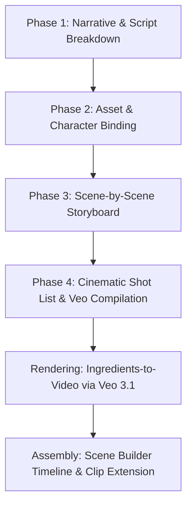

# Supplementary Research: Storyboarding & Multi-Clip Production Pipeline

## 1. End-to-End Production Pipeline Architecture

To create cohesive, narrative AI films using Google Flow, Veo 3.1, and Gemini Omni, production must follow a strict 4-phase sequential pipeline before rendering video clips:



---

## 2. Phase Breakdown for the AI Agent Skill

### Phase 1: Narrative & Script Breakdown
- **Role:** AI Creative Director / Screenwriter (Gemini Omni Flash).
- **Inputs:** User's logline, theme, genre, duration goal (e.g. 30s short = four to five 6–8s clips).
- **Outputs:**
  - Concise beat sheet (Act I: Hook / Establishing -> Act II: Conflict / Interaction -> Act III: Climax / Resolution).
  - Explicit scene boundaries and temporal allocation per beat.

### Phase 2: Asset & Character Binding ("Ingredients" Preparation)
- **Role:** Virtual Production Designer / Art Dept.
- **Rule:** Never generate dynamic video clips until characters, key props, and environments are locked into static reference assets.
- **Master Character Sheet Blueprint:**
  - Name, age, exact ethnicity, bone structure, hairstyle and color.
  - Consistent wardrobe: specific garments, fabrics, colors, distressing.
  - Image generation: Render 3 neutral portrait/full-body shots on clean, solid grey/off-white studio backgrounds via Imagen.
  - Register as **"Ingredients"** inside Google Flow.
- **Environment & Style Key Blueprint:**
  - Color palette (e.g., desaturated cool teal with warm amber accents).
  - Film stock / lighting reference (e.g., 35mm anamorphic, heavy rim light, volumetric haze).

### Phase 3: Scene-by-Scene Storyboarding
- **Role:** Storyboard Artist.
- **Format:** Multi-panel visual breakdown.
- **Specifications per Storyboard Panel:**
  - Panel Number & Timeline Stamp (e.g., `Shot 01 | 00:00 - 00:06`).
  - Narrative Objective: What narrative information or emotional beat this panel delivers.
  - Visual Composition: Foreground, midground, background placement.
  - Keyframe Image: Generated via Imagen or selected from character reference assets to serve as `first_frame` or visual anchor.

### Phase 4: Cinematic Shot List & Veo Compilation
- **Role:** Virtual Cinematographer / AI Prompt Engineer.
- **Format:** Structured technical breakdown translated directly into production-ready Veo 3.1 prompts.
- **Shot List Schema:**
  - `Shot ID`: e.g., `SH_01`
  - `Shot Type & Framing`: Extreme Wide, Wide, Medium, Medium Close-Up, Extreme Close-Up, Low-Angle, Dutch Angle.
  - `Camera Movement`: Dolly-in, Lateral Tracking, Locked Tripod, Handheld Gimbal, Crane Up.
  - `Lens & Optics`: 24mm Wide, 50mm Anamorphic, 85mm Portrait, Macro.
  - `Lighting & Environment`: Key light position, practical lights, atmospheric particles.
  - `Subject Action`: Single isolated biomechanical movement.
  - `Dialogue & Delivery`: Attribution verb + delivery modifier + quoted line (if applicable).
  - `Audio Layer`: SFX, ambient acoustic space, explicit negative audio.
  - `Compiled Veo 3.1 Prompt`: Final single-block text prompt conforming to the front-loaded syntax standard.

---

## 3. Master AI Director Production Prompt Protocol

The following prompt framework can be programmed into the Antigravity skill or used by an orchestrating agent to execute the pipeline interactively with the user:

```text
Act as an expert AI Creative Director and Virtual Production Supervisor operating inside Google Flow. We are producing a [DURATION]-second cinematic AI short film titled "[PROJECT_TITLE]". 

CORE NARRATIVE PREMISE:
[PREMISE_TEXT]

Execute the pre-production pipeline in four distinct, sequential stages:

STAGE 1: ASSET & CHARACTER BINDING
- Define verbatim master descriptions for all recurring characters, specific wardrobe, key props, and overarching color grading palette.
- Formulate the exact Imagen prompts to generate clean, neutral reference sheets (Ingredients).

STAGE 2: STORYBOARD SEQUENCE (4–6 Shots)
- For each beat, specify narrative goal, visual composition, and first-frame anchor description.

STAGE 3: CINEMATIC SHOT LIST SPECIFICATION
For each shot, provide:
- Shot ID & Duration (4s, 6s, or 8s)
- Shot Type & Framing
- Camera Movement (Single verb)
- Optics & Lens Choice
- Lighting Rig & Ambiance
- Action (One primary movement)
- Dialogue & Audio Cues

STAGE 4: COMPILED VEO 3.1 GENERATION PROMPTS
Translate each shot into an optimized Veo 3.1 prompt strictly following the formula:
[Framing/Shot Type] + [Subject with Verbatim Character Description] + [Action] + [Environment/Context] + [Lighting & Style] + [Camera Move] + [Dialogue in Quotes] + Audio: [SFX & Ambience]

Confirm and present Stages 1–3 for review before compiling final generation blocks.
```
